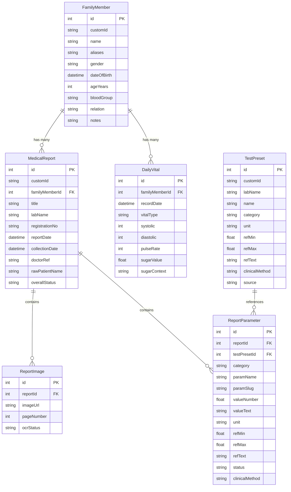

# Database & Prisma Specification

## ORM Configuration
- Schema file: `prisma/schema.prisma`
- Provider: PostgreSQL
- Direct connection pooling configured in `src/lib/db.ts` with singleton protection.

## Data Models

## Seeding & Scripts
- `prisma/seed.ts`: Seeds initial family members, sample historical reports, daily vitals, and ~50 standard clinical test presets (`initialTestPresets`).
- `scripts/seed_postgres.ts`: Direct PostgreSQL seeding script.
- `scripts/clear_database.ts`: Safe database wipe script for testing environments.
